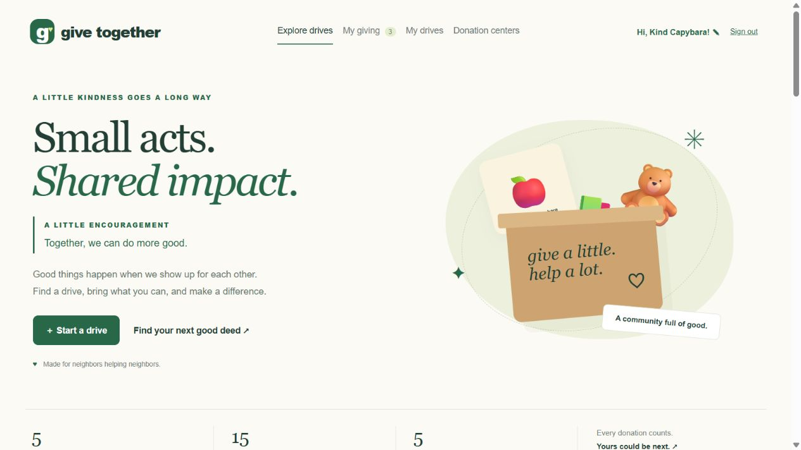

# Give Together

Small acts. Shared impact.

Give Together helps people start donation drives, find drives to join, and report when they drop off their donations. Organizers can confirm deliveries and track needed items.

This student project runs locally with Google sign-in, a SQLite database, and Python features for donation ideas, progress messages, item counts, and daily encouragement. The screenshot shows sample activity for a presentation.

## Demo

**[▶ Watch the demo on YouTube](https://www.youtube.com/watch?v=EiBx3tYZNY8)**

## Open the website

1. Install Node.js version 24 or newer if needed.
2. Double-click `START.bat` on Windows and keep the window open. On the first run, it downloads Google's official sign-in library.
3. Visit **http://localhost:3000** in Chrome or Edge.

On other computers, run `npm install` once, then `npm start` from this folder.

## Connect Google (one-time setup)

Open **http://localhost:3000/google-setup.html** for the step-by-step setup guide, or open `public/google-setup.html` from this folder. Follow it with a trusted adult.

You will create a Google web Client ID, allow `http://localhost` and `http://localhost:3000`, and paste the ID into a `.env` file copied from `.env.example`. No client secret is needed. Restart the server afterward.

Until this is done, everyone can browse, but nobody can sign in, create drives, or join them. The site shows a clear setup message. A real Google sign-in could not be tested without your own configured Client ID; automated tests check signed-token verification with local test keys.

After connecting Google, click **Join with Google**, then choose a nickname. The same Google account signs you back in next time. We save its stable identifier, not its Google name, email, photo, or password. Google may require approval for supervised or school accounts. Sign-in does not verify a person's age or prove that an adult is supervising.

Old password sign-in is disabled. Earlier local records remain in the database, but Google accounts are separate. They are never automatically linked by name or email.

## Use the app

1. Click **Start a drive** and describe what to collect, where to drop it off, and the end date.
2. People join and say what they plan to bring.
3. The organizer opens **Checklist** and checks **Received** when items arrive.
4. **My giving** shows drives you joined. **My drives** shows drives you created. You can switch reminders off or leave a drive you joined.

Reminders appear in the app. Optional browser notifications run at most once daily per pending drive while the site is open and the donor is signed in. There are no closed-browser alerts, emails, or texts. Reminders stop after receipt, opting out, leaving, or the drive ending.

## Files

- `student_features.py`: the Python starting points.
- `public/student-features.json`: this gets generated by the Python file; the browser reads it.
- `public/index.html`, `public/style.css`, `public/app.js`: the website.
- `public/google-signin.js`, `google-auth.mjs`: Google sign-in.
- `server.mjs`: account sessions, donation rules, and SQLite storage.
- `test.mjs`: verification, privacy, permission, and donation-workflow tests.

### Donation center directory
The Donation centers section searches exact five-digit U.S. ZIP codes and filters by Nonprofit or City program. It is a growing local directory, not a nationwide live search or distance-radius search. The starter coverage is 94403 (Samaritan House), 94402 (San Mateo Main Library), and 94070 (Second Harvest Bing Center). Official donation pages are linked on the cards. 

Sources:
- https://samaritanhousesanmateo.org/donate/
- https://www.cityofsanmateo.org/510/Friends-of-the-Library-Donations
- https://www.cityofsanmateo.org/m/directory/department?did=90
- https://www.shfb.org/give-help/donate-food/
- https://www.shfb.org/docs/aboutus/annualreport/annualreport_0910.pdf (Bing Center street address; current drop-off availability checked on the current donation page)
- https://www.feedingamerica.org/find-your-local-foodbank (external nationwide directory)

### Features
Explore drives is a single-page directory with three exclusive groups in order: New to you, You’ve joined, and Created by you. Ownership takes priority if an organizer also signed up. Each group has a count, and signed-in cards show a relationship label. Search, category, and Include ended drives apply to all three groups. Navigation scrolls to the groups. Older /?page=explore links also load the complete single-page interface.

You can create drives or sign up for the drives

Daily quote: greetings.py supplies positive_message(). The AI-written daily_quote_bridge.py and daily-quote.mjs expose GET /api/daily-quote. The browser shows it under the main heading and checks every minute while visible, and when returning to the tab. Quotes use the server computer’s local date. Repeats across days are possible. 
